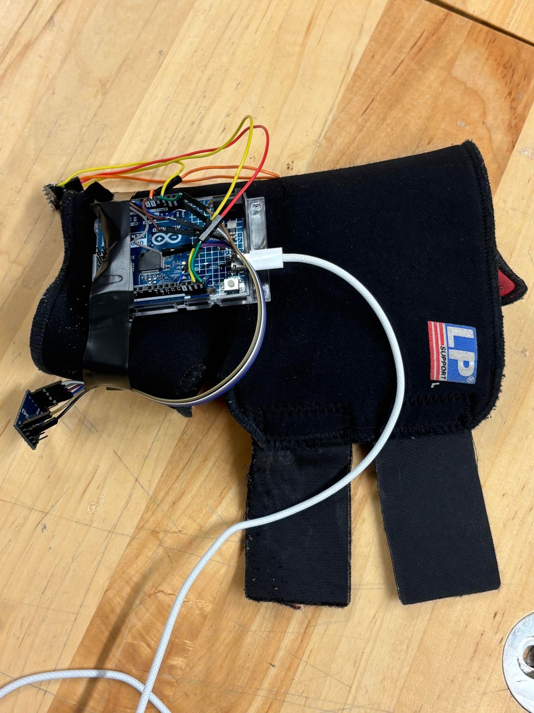
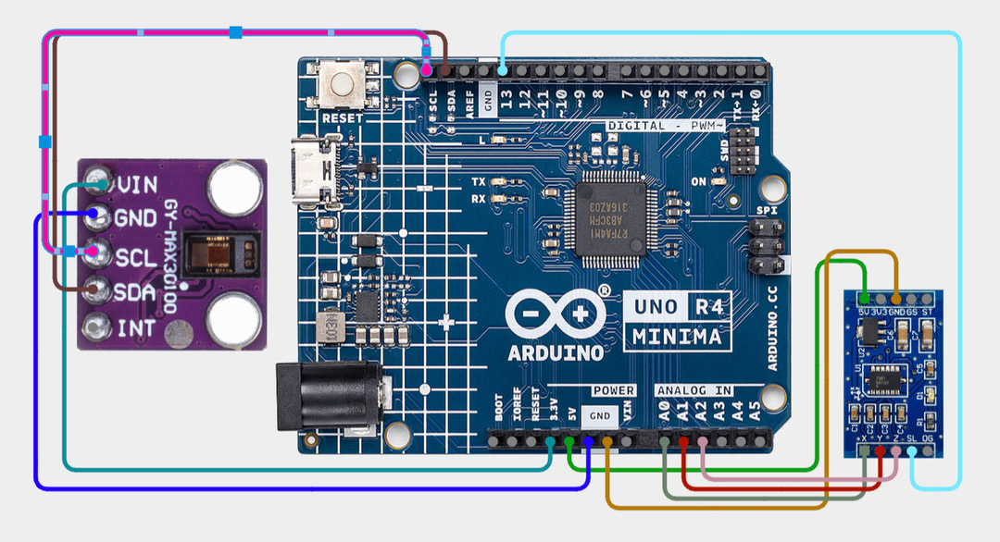
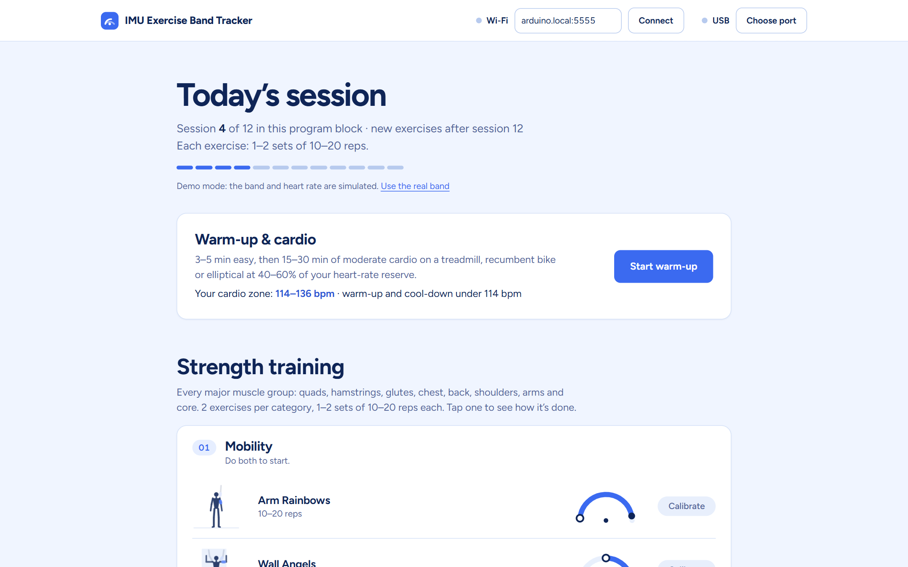
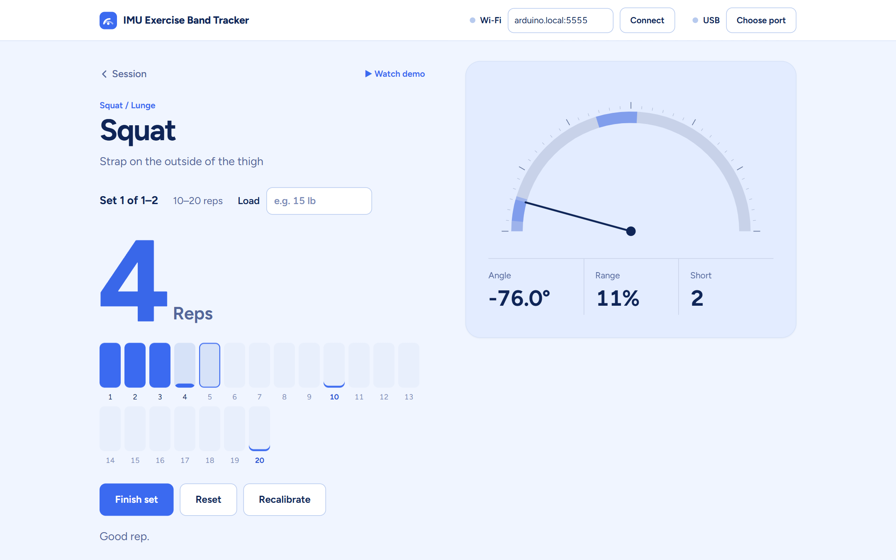
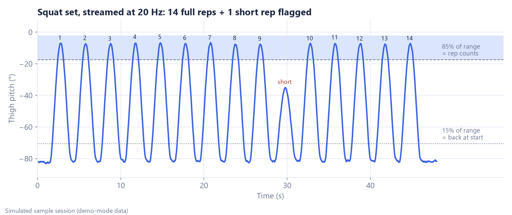
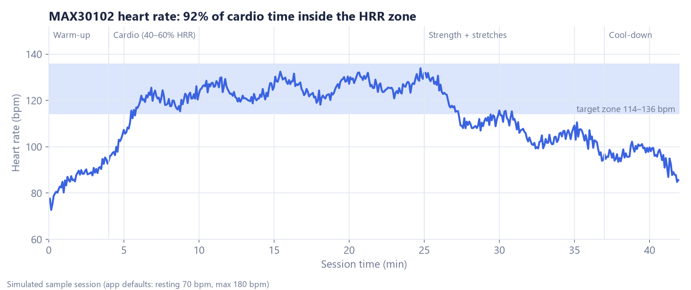
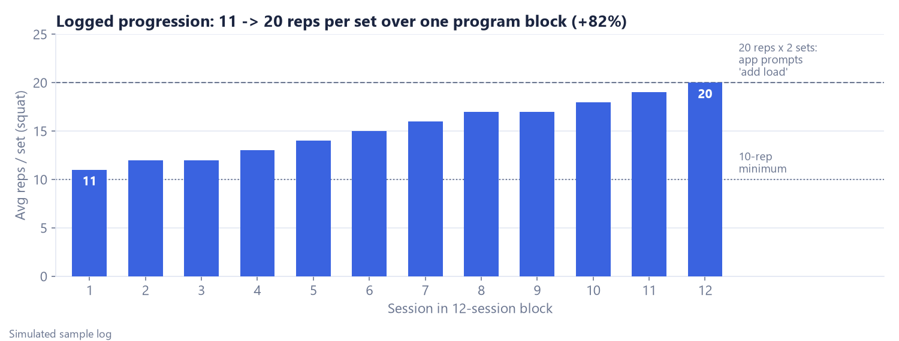

# IMU Exercise Wristband

A wearable motion-and-vitals band, plus a web app that coaches a full exercise session around it. An Arduino Uno R4 Minima reads a 3-axis accelerometer and a pulse sensor on the arm or thigh, streams joint angle and heart rate to the browser at 20 Hz, and the site counts reps, flags short reps, keeps you in your heart-rate zone and logs every set.

The session follows the **CCCARE** exercise program from the University of Waterloo (Centre for Community, Clinical and Applied Research in Exercise): warm-up and 15–30 min of cardio at 40–60% of heart-rate reserve, then 1–2 sets of 10–20 reps of two exercises in each functional category (squat, push, hinge, pull, carry, core), stretches, and a cool-down. The band replaces the paper log and the "did that rep count?" guesswork.

Built for ECE 198 (Project Studio) at the University of Waterloo by Group 4.



## At a glance

| | |
|---|---|
| Sensors | MMA7361 3-axis accelerometer (analog, ±1.5 g) and MAX30102 pulse sensor (I²C) |
| Board | Arduino Uno R4 Minima, 200-line sketch |
| Stream rate | 20 Hz JSON over USB serial at 115200 baud; up to ~25 Hz polling over Wi-Fi |
| Heart rate | 400 samples/s, averaged 4× in hardware to 100 Hz; 4-beat rolling average |
| Program | 16 exercises in 8 categories, 12-session program block |
| Rep rule | counts at ≥85% of the calibrated range, resets within 15% of the start |
| Web app | React 19 + TypeScript + Vite, ~2,000 lines, no backend |
| Tests | 26 unit tests + 14 Playwright end-to-end tests run on desktop and mobile (28 runs) |

## How it works

```
 MMA7361 ──analog A0/A1/A2──┐
                            ├─► Uno R4 Minima ──USB serial 115200 baud, 1 JSON line / 50 ms──► Web Serial (Chrome/Edge)
 MAX30102 ──I²C SDA/SCL─────┘         │                                                        │
                                      └──Wi-Fi HTTP :5555 (polled every ~40 ms)──────────────► React app
                                                                                                 ├─ calibration (A/B angles)
                                                                                                 ├─ rep + hold engine
                                                                                                 ├─ heart-rate zones (Karvonen)
                                                                                                 └─ session log (localStorage)
```

### Firmware (`arduino_code.ino`)

- **Angles from gravity.** Each axis is converted to g (`(raw·5 V/1023 − 1.65 V) / 0.8 V/g`) and smoothed with an exponential filter (α = 0.05, about a 100 ms time constant). Pitch and roll come from `atan2` of the filtered gravity vector.
- **Roll is zeroed at power-up.** The sketch waits 1.5 s for the filter to settle, stores the resting roll, and reports roll relative to it, wrapped to ±180°. Roll is ignored when the tilt is under 0.3 g, where it is undefined.
- **Robust heart rate.** The MAX30102 FIFO holds 32 samples (about 320 ms), so the loop services it at least every 250 ms and drops the buffer if it gets within 4 samples of overflowing. Beats are timestamped per sample (10 ms apart), not per loop, so intervals stay accurate. Readings over 220 bpm are treated as double detections, gaps implying under 30 bpm as missed beats, and no finger (IR < 50,000) or 3 s without a beat resets the reading. A bpm is only sent once 4 consecutive good beats agree.
- **Small, fixed protocol.** Every 50 ms the board prints one line:

  ```json
  {"pitch":-72.4,"roll":3.1,"gx":-0.951,"gy":0.054,"gz":0.302,"ir":81234,"bpm":72}
  ```

  `bpm` is `null` until the reading is valid. Calibration and rep counting live in the browser, so the band firmware stays simple and never needs reflashing to add an exercise.

### Serial communication

The site reads the band with the **Web Serial API**: open the port at 115200 baud, pipe it through a `TextDecoderStream`, split on newlines, and `JSON.parse` each complete line. A partial line is held until the rest arrives, and a corrupted line is skipped rather than crashing the session. If the Arduino IDE's Serial Monitor is holding the port, the user gets a plain-language "port is busy" message. The same sample format also arrives over Wi-Fi (HTTP polling with a 1.5 s timeout; 3 misses in a row marks the band offline), and a `?demo` mode simulates both sensors, including random short reps, so the whole app can be used without hardware.

### Rep counting and coaching

1. **Calibrate.** Strap the band where the app shows (thigh for squats, upper arm for presses, chest for deadlifts…), then capture the start (A) and end (B) angles.
2. **Count.** Each sample is turned into progress along A→B. A rep counts when you reach 85% of the range and come back within 15% of the start. A movement that turns around between 30% and 85% is logged as a **short rep** with the percentage reached ("Short rep — 62%. Go further.").
3. **Holds.** Planks, carries and stretches run a timer only while you stay within ±12° of the start position.
4. **Progress.** Cues fire at 10 reps ("you're in range") and 20 reps. Once you hit 20 reps on both sets, the app tells you to add load. Every set (reps, short reps, load) is saved per exercise and per day.

### Heart-rate zones

Cardio targets use heart-rate reserve (Karvonen): `target = rest + % × (max − rest)`. With the default resting 70 bpm and max 180 bpm, 40–60% HRR gives a **114–136 bpm** zone, and warm-up and cool-down stay under 114. Heart rate comes from the band, a Bluetooth chest strap, or is typed in from the machine. The app gives machine-specific tips (treadmill, recumbent bike, elliptical) to move back into the zone.

## Hardware and wiring



| Part | Pin | Arduino |
|---|---|---|
| MMA7361 | X / Y / Z | A0 / A1 / A2 |
| MMA7361 | VCC, SL (sleep, held high) | 3.3 V |
| MMA7361 | GND | GND |
| GY-MAX30102 | SDA / SCL | SDA / SCL header |
| GY-MAX30102 | VIN / GND | 3.3 V / GND |

## The website

Session overview: warm-up and cardio with your personal zone, then each exercise category with its calibration status:



A live squat set: rep counter, rep-by-rep bar for the 10–20 range, and a dial showing the current angle, range reached and short reps:



## Sample session data

The charts below are from a **simulated** session (the same signal shapes demo mode produces), to show what the band streams and what the app does with it.

A 48 s squat set at 20 Hz (960 samples). 14 reps cross the 85% line; the 10th movement only reaches about 62% of the range and is logged as a short rep instead of counted:



Heart rate across a 42-minute session. During the 21 minutes of cardio, 92% of readings stay inside the 114–136 bpm zone:



Logged squat reps per set across one 12-session block, going from 11 to 20 reps (+82%) until the app prompts to add load:



## Running it

You need Node 20+ and Chrome or Edge.

```
cd website
npm install
npm run dev
```

Then open:

- http://localhost:8080/?demo: demo mode, simulates the band and heart rate (no hardware needed)
- http://localhost:8080/: real band, connect over USB ("Choose port") or Wi-Fi (default `arduino.local:5555`)

Use `localhost`, not a double-clicked file. USB and Bluetooth heart-rate monitors only work on a secure page in Chrome or Edge.

To flash the band, open `arduino_code.ino` in the Arduino IDE, install the SparkFun MAX3010x library, select the Uno R4 Minima and upload. Close the Serial Monitor before connecting from the website.

Other scripts (from `website/`): `npm run build`, `npm run typecheck`, `npm run lint`, `npm test` (unit tests for rep counting, heart-rate zones and the session log) and `npm run test:e2e` (Playwright, desktop and mobile; run `npx playwright install chromium` once first).

## Repository

- `arduino_code.ino`: firmware for the band (accelerometer, heart rate, JSON output)
- `website/`: the tracker web app (React + TypeScript + Vite)
- `docs/images/`: photos, wiring, screenshots and charts used in this README

## Use of AI

Claude Opus 5.5 was used as a coding assistant on the website. It did the repetitive work: building out the 16-exercise list and the matching page and styles for each exercise, and helping lay out and design parts of the UI. It also helped track down bugs, write tests and format this README. The hardware design, wiring, sensor choice, firmware logic and the CCCARE program mapping were done by the team, and all AI-written code was reviewed and tested on the band.
